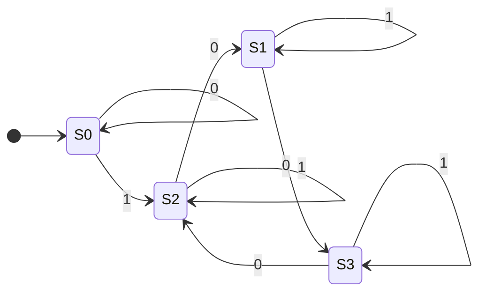
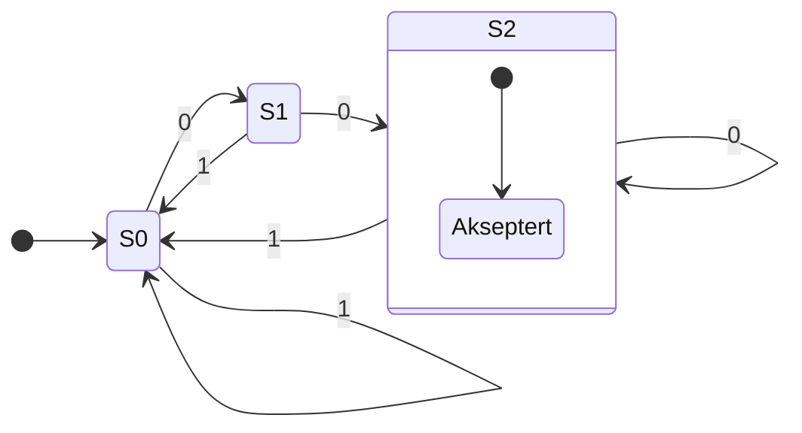
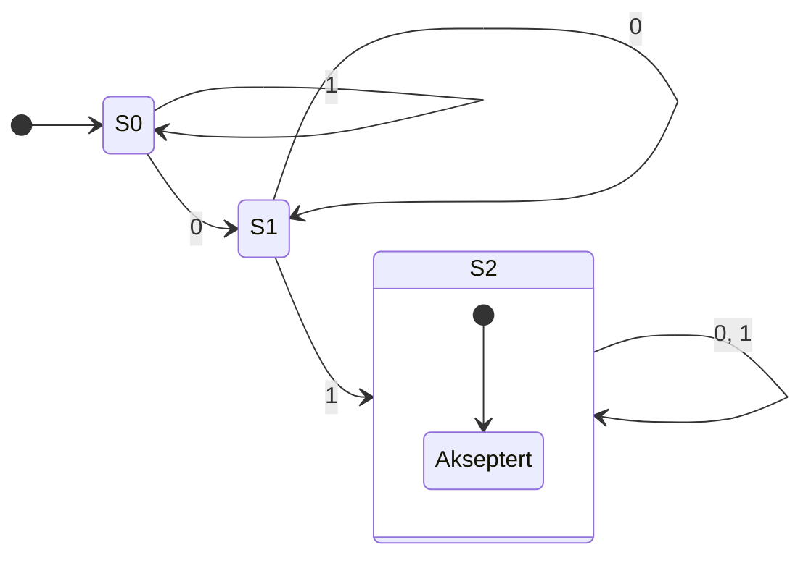
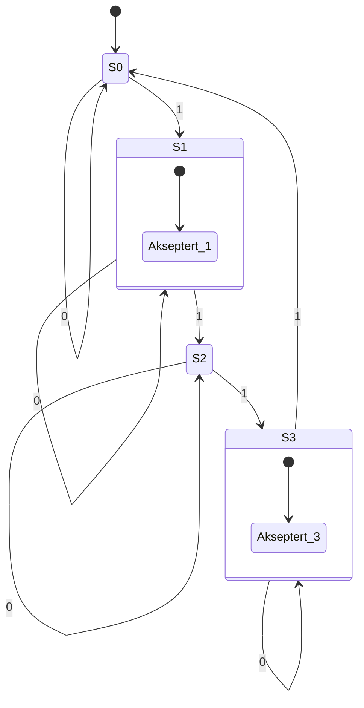

# MAT210 – Obligatorisk arbeidskrav 2 (Løysingsforslag)

## Oppgåve 1

### a) Pascals trekant til og med $n=8$

Vi byggjer opp Pascals trekant der kvart tal er summen av dei to tala rett over seg (radnummeret tilsvarer $n$, og posisjonen i rada tilsvarer $k$ frå $0$ til $n$):

* **$n=0$:** $1$
* **$n=1$:** $1 \quad 1$
* **$n=2$:** $1 \quad 2 \quad 1$
* **$n=3$:** $1 \quad 3 \quad 3 \quad 1$
* **$n=4$:** $1 \quad 4 \quad 6 \quad 4 \quad 1$
* **$n=5$:** $1 \quad 5 \quad 10 \quad 10 \quad 5 \quad 1$
* **$n=6$:** $1 \quad 6 \quad 15 \quad 20 \quad 15 \quad 6 \quad 1$
* **$n=7$:** $1 \quad 7 \quad 21 \quad 35 \quad 35 \quad 21 \quad 7 \quad 1$
* **$n=8$:** $1 \quad 8 \quad 28 \quad 56 \quad 70 \quad 56 \quad 28 \quad 8 \quad 1$

### b) Bruk trekanten til å vise likskapen

Vi skal vise at:
$$\binom{6}{2}\binom{7}{4}\binom{8}{3} = \binom{6}{3}\binom{7}{2}\binom{8}{4}$$

Frå Pascals trekant i oppgåve a) les vi av verdiane for dei respektive radene ($n$) og indeksane ($k$, der første tal er $k=0$):

* **Venstre side (VS):**
  * $\binom{6}{2} = 15$
  * $\binom{7}{4} = 35$
  * $\binom{8}{3} = 56$
  * $\text{VS} = 15 \cdot 35 \cdot 56 = 29\,400$

* **Høgre side (HS):**
  * $\binom{6}{3} = 20$
  * $\binom{7}{2} = 21$
  * $\binom{8}{4} = 70$
  * $\text{HS} = 20 \cdot 21 \cdot 70 = 29\,400$

Sidan $\text{VS} = \text{HS} = 29\,400$, stemmer likskapen.

### c) Vis Hexagonidentiteten ved algebraiske reknereglar

Vi skal vise den generelle hexagonidentiteten:
$$\binom{n-1}{k-1}\binom{n}{k+1}\binom{n+1}{k} = \binom{n-1}{k}\binom{n}{k-1}\binom{n+1}{k+1}$$

Vi nyttar definisjonen av binomialkoeffisienten, $\binom{a}{b} = \frac{a!}{b!(a-b)!}$, på begge sider av likskapsteiknet.

**Venstre side (VS):**
$$\text{VS} = \frac{(n-1)!}{(k-1)!((n-1)-(k-1))!} \cdot \frac{n!}{(k+1)!(n-(k+1))!} \cdot \frac{(n+1)!}{k!((n+1)-k)!}$$

Vi forenklar uttrykka i nemnarane:
$$\text{VS} = \frac{(n-1)!}{(k-1)!(n-k)!} \cdot \frac{n!}{(k+1)!(n-k-1)!} \cdot \frac{(n+1)!}{k!(n-k+1)!}$$

Vi samlar teljarane og nemnarane:
$$\text{VS} = \frac{(n-1)! \cdot n! \cdot (n+1)!}{(k-1)! \cdot k! \cdot (k+1)! \cdot (n-k-1)! \cdot (n-k)! \cdot (n-k+1)!}$$

**Høgre side (HS):**
$$\text{HS} = \frac{(n-1)!}{k!((n-1)-k)!} \cdot \frac{n!}{(k-1)!(n-(k-1))!} \cdot \frac{(n+1)!}{(k+1)!((n+1)-(k+1))!}$$

Vi forenklar uttrykka i nemnarane:
$$\text{HS} = \frac{(n-1)!}{k!(n-k-1)!} \cdot \frac{n!}{(k-1)!(n-k+1)!} \cdot \frac{(n+1)!}{(k+1)!(n-k)!}$$

Vi samlar teljarane og nemnarane og sorterer faktorane:
$$\text{HS} = \frac{(n-1)! \cdot n! \cdot (n+1)!}{(k-1)! \cdot k! \cdot (k+1)! \cdot (n-k-1)! \cdot (n-k)! \cdot (n-k+1)!}$$

Sidan teljar og nemnar på venstre side er identiske med teljar og nemnar på høgre side, er identiteten bevist: $\text{VS} = \text{HS}$.

### d) Finn rekkene for $\binom{9}{k}$ og $\binom{11}{k}$

Vi har gitt rekka for $n=10$:
$$1, \quad 10, \quad 45, \quad 120, \quad 210, \quad 252, \quad 210, \quad 120, \quad 45, \quad 10, \quad 1$$

#### 1. Rekka rett under: $\binom{11}{k}$
Vi bruker Pascals identitet $\binom{11}{k} = \binom{10}{k-1} + \binom{10}{k}$, der vi set $1$ på kvar ende og summerer to og to nabotal frå $n=10$-rekka:
* $k=0$: $1$
* $k=1$: $1 + 10 = 11$
* $k=2$: $10 + 45 = 55$
* $k=3$: $45 + 120 = 165$
* $k=4$: $120 + 210 = 330$
* $k=5$: $210 + 252 = 462$
* $k=6$: $252 + 210 = 462$
* $k=7$: $210 + 120 = 330$
* $k=8$: $120 + 45 = 165$
* $k=9$: $45 + 10 = 55$
* $k=10$: $10 + 1 = 11$
* $k=11$: $1$

**Rekka for $\binom{11}{k}$ er:**
$$1, \quad 11, \quad 55, \quad 165, \quad 330, \quad 462, \quad 462, \quad 330, \quad 165, \quad 55, \quad 11, \quad 1$$

#### 2. Rekka rett over: $\binom{9}{k}$
Vi bruker samanhengen $\binom{9}{k} = \binom{10}{k} - \binom{9}{k-1}$, der vi startar med $\binom{9}{0} = 1$ på venstre side og trekkjer frå for kvart steg mot høgre:
* $k=0$: $1$
* $k=1$: $10 - 1 = 9$
* $k=2$: $45 - 9 = 36$
* $k=3$: $120 - 36 = 84$
* $k=4$: $210 - 84 = 126$
* $k=5$: $252 - 126 = 126$
* $k=6$: $210 - 126 = 84$
* $k=7$: $120 - 84 = 36$
* $k=8$: $45 - 36 = 9$
* $k=9$: $10 - 9 = 1$ (Kontroll: $1 - 1 = 0$, som stemmer).

**Rekka for $\binom{9}{k}$ er:**
$$1, \quad 9, \quad 36, \quad 84, \quad 126, \quad 126, \quad 84, \quad 36, \quad 9, \quad 1$$

## Oppgåve 2

### a) Kombinasjonar og speletid i Vikinglotto

* **Antal kombinasjonar:**
  I Vikinglotto trekkjer ein $6$ tal av $48$ utan tilbakelegging og utan omsyn til rekkjefølgje:
  $$\binom{48}{6} = \frac{48!}{6!(48-6)!} = \frac{48 \cdot 47 \cdot 46 \cdot 45 \cdot 44 \cdot 43}{6 \cdot 5 \cdot 4 \cdot 3 \cdot 2 \cdot 1} = \frac{8\,835\,488\,640}{720} = 12\,271\,512$$
  Det finst **$12\,271\,512$** ulike kombinasjonar.

* **Kor mange år før ein er sikker på å vinne:**
  Dersom du leverer inn $10$ ulike rekker kvar veke, og same rekke ikkje kan trekkast fleire gonger, treng du maksimalt:
  $$\text{Antal veker} = \frac{12\,271\,512}{10} = 1\,227\,151{,}2 \text{ veker}$$
  (Sidane det berre er éi trekking i veka, må du spele i $1\,227\,152$ veker for å dekke siste rekka, eller $1\,227\,151{,}2$ veker i snitt/eksakt).

  Reknar vi om til år (med $52$ veker i året):
  $$\text{Antal år} = \frac{1\,227\,151{,}2}{52} \approx 23\,599{,}06 \text{ år}$$
  *(Merk: Med $52{,}14$ veker i eit gjennomsnittsår på $365$ dagar vert det $\frac{1\,227\,151{,}2}{365/7} \approx 23\,534{,}4$ år).*
  Det tek altså om lag **$23\,599$ år** (eller $23\,600$ år) før ein er garantert hovudgevinsten.

### b) Rekn ut $(x+y)^7$

Vi bruker binomialsetninga og koeffisientane frå rad $n=7$ i Pascals trekant ($1, 7, 21, 35, 35, 21, 7, 1$):

$$(x+y)^7 = \sum_{k=0}^{7} \binom{7}{k} x^{7-k} y^k$$

$$(x+y)^7 = x^7 + 7x^6y + 21x^5y^2 + 35x^4y^3 + 35x^3y^4 + 21x^2y^5 + 7xy^6 + y^7$$

### c) Finn koeffisienten til $x^5y^8$ i $(x+2y)^{13}$

Frå binomialsetninga er det generelle leddet i $(x+2y)^{13}$ gitt ved:
$$\binom{13}{k} x^{13-k} (2y)^k = \binom{13}{k} 2^k x^{13-k} y^k$$

For å få $x^5y^8$ må vi ha $k = 8$ (sidan $13 - 8 = 5$). Koeffisienten vert då:
$$\binom{13}{8} \cdot 2^8$$

Vi reknar ut delane:
* $\binom{13}{8} = \binom{13}{5} = \frac{13 \cdot 12 \cdot 11 \cdot 10 \cdot 9}{5 \cdot 4 \cdot 3 \cdot 2 \cdot 1} = 13 \cdot 11 \cdot 9 = 1\,287$
* $2^8 = 256$

Multipliserer saman:
$$1\,287 \cdot 256 = 329\,472$$

Koeffisienten til $x^5y^8$ er **$329\,472$**.

### d) Uttrykk summen som eit lukka uttrykk $a^p$

Vi har summen:
$$\sum_{i=0}^{10} \binom{10}{i} 4^i$$

Vi kan skrive om dette ved å setje inn ein faktor $1^{10-i}$ (sidan $1^{10-i} = 1$):
$$\sum_{i=0}^{10} \binom{10}{i} 1^{10-i} \cdot 4^i$$

Dette matchar binomialsetninga $\sum_{i=0}^{n} \binom{n}{i} x^{n-i} y^i = (x+y)^n$ med $n=10$, $x=1$ og $y=4$:
$$\sum_{i=0}^{10} \binom{10}{i} 4^i = (1 + 4)^{10} = 5^{10}$$

Det lukka uttrykket er **$5^{10}$**.

## Oppgåve 3

### Regulære uttrykk for bitstrengar

* **a) Mengda av bitstrengar som har partalslengde (t.d. $0101$, eller den tomme strengen $\lambda$):**
  Kvart par av teikn har lengde $2$, og kvart teikn kan vere $0$ eller $1$. Dette kan gjentakast $0$ eller fleire gonger:
  $$((0 \mid 1)(0 \mid 1))^* \quad \text{eller} \quad (00 \mid 01 \mid 10 \mid 11)^*$$

* **b) Mengda av bitstrengar som sluttar med $0$ og ikkje inneheld $11$:**
  For å unngå to $1$-arar på rad, må kvar $1$ vere etterfølgt av minst éin $0$. Sidan strengen uansett må slutte på $0$, kan strengen byggjast opp av blokker som anten er berre `0` eller `10`:
  $$(0 \mid 10)^*0 \quad \text{eller alternativt} \quad 0^*(100^*)^* \text{ (dersom minst éin 1) } \implies (0 \mid 10)^+$$
  *(Forklaring: $(0 \mid 10)^+ = (0 \mid 10)(0 \mid 10)^*$ sikrar at strengen har lengde $\ge 1$, alltid sluttar på $0$, og aldri har to $1$-arar etter kvarandre).*

* **c) Mengda av bitstrengar som inneheld oddetals antal $0$-ar:**
  Vi må ha minst éin $0$ (med vilkårleg antal $1$-arar rundt), etterfølgt av $0$ eller fleire par av $0$-ar (med vilkårleg antal $1$-arar imellom):
  $$1^*01^*(01^*01^*)^*$$

## Oppgåve 4

### a) Grammatikk $G$
Gitt grammatikken $G$ med $V = \{0, 1, S\}$, $V_T = \{0, 1\}$, startsymbol $S$ og produksjonsreglar:
$$S \to 0 \quad \text{og} \quad S \to 11S$$

Desse reglane genererer strengar som startar med eit partals antal $1$-arar ($0, 2, 4, 6, \dots$) og sluttar med éin $0$, altså språket $L(G) = \{(11)^n 0 \mid n \ge 0\}$.

**Fire strengar som blir genererte av $G$:**
1. $0$ (via $S \Rightarrow 0$)
2. $110$ (via $S \Rightarrow 11S \Rightarrow 110$)
3. $11110$ (via $S \Rightarrow 11S \Rightarrow 1111S \Rightarrow 11110$)
4. $1111110$ (via $S \Rightarrow 11S \Rightarrow 1111S \Rightarrow 111111S \Rightarrow 1111110$)

### b) Grammatikk generert av uttrykket $(01)^*$
*(Merk: Står som andre punkt a) i oppgåveteksten).*

Uttrykket $(01)^*$ genererer den tomme strengen $\lambda$ (eller $\varepsilon$), $01$, $0101$, $010101$, osv.

Vi kan definere grammatikken $G = (V, V_T, S, P)$ slik:
* **Alfabet / variablar:** $V = \{0, 1, S\}$
* **Terminalsymbol:** $V_T = \{0, 1\}$
* **Startsymbol:** $S$
* **Produksjonsreglar $P$:**
  $$S \to 01S \mid \lambda$$
  *(Alternativt dersom ein ønskjer regulær grammatikk på høgrelineær form: $S \to 0A \mid \lambda$, $A \to 1S$).*

## Oppgåve 5

### a) Analyse av tilstandsdiagram

Frå diagrammet på side 2 les vi av:

* **i) Alle tilstandar ($S$):**
  $$\{S_0, S_1, S_2\}$$

* **ii) Alle inngangssymbol ($I$):**
  $$\{0, 1\}$$

* **iii) Starttilstanden:**
  $$S_0$$

* **iv) Aksepterande tilstandar ($F$):**
  $$\{S_2\}$$

* **v) Nestetilstand- (overgangs-) tabell:**

| Tilstand | Inngang $0$ | Inngang $1$ |
| :--- | :---: | :---: |
| $\to S_0$ | $S_0$ | $S_1$ |
| $S_1$ | $S_2$ | $S_1$ |
| $*S_2$ | $S_2$ | $S_2$ |

*(Merknad: $\to$ markerer starttilstand og $*$ markerer aksepterande tilstand).*

### b) Teikn tilstandsdiagram for tabellen

Tabellen er gitt ved:
- $S_0 \xrightarrow{0} S_0, \quad S_0 \xrightarrow{1} S_2$
- $S_1 \xrightarrow{0} S_3, \quad S_1 \xrightarrow{1} S_1$
- $S_2 \xrightarrow{0} S_1, \quad S_2 \xrightarrow{1} S_2$
- $S_3 \xrightarrow{0} S_2, \quad S_3 \xrightarrow{1} S_3$

*(Vi antar at $S_0$ er starttilstand).*

### c) Sluttilstand for gitte inngangsstrengar (startar i $S_0$)

* **i. Streng: `00101`**
  $$S_0 \xrightarrow{0} S_0 \xrightarrow{0} S_0 \xrightarrow{1} S_2 \xrightarrow{0} S_1 \xrightarrow{1} S_1$$
  Maskina endar i tilstand **$S_1$**.

* **ii. Streng: `1100`**
  $$S_0 \xrightarrow{1} S_2 \xrightarrow{1} S_2 \xrightarrow{0} S_1 \xrightarrow{0} S_3$$
  Maskina endar i tilstand **$S_3$**.

### d) Teikn overgangsdiagram for regulære uttrykk

#### i. $(0 \mid 1)^*00$ (strengar som sluttar på `00`)
* $S_0$: Starttilstand (har ikkje sett `0` på slutten)
* $S_1$: Har sett éin `0`
* $S_2$: Aksepterande tilstand (har sett `00` på slutten)

*(Merk: $S_2$ er aksepterande tilstand).*

#### ii. $1^*00^*1(0 \mid 1)^*$ (minst éin `0` før første `1` etterfølgt av kva som helst, eller meir presist: vilkårleg mange `1`-arar, så minst éin `0`, så minst éin `1`, deretter kva som helst)
* $S_0$: Starttilstand (har berre sett `1`-arar)
* $S_1$: Har sett minst éin `0` etter eventuelle innleiande `1`-arar
* $S_2$: Aksepterande tilstand (har deretter sett `1`, aksepterer resten)

*(Merk: $S_2$ er aksepterande tilstand).*

## Oppgåve 6

Frå tilstandsdiagrammet på side 3 les vi først av overgangstabellen for maskina $A$:
* Starttilstand: $S_0$
* Aksepterande tilstandar ($F$): $\{S_0, S_2\}$
* Ikkje-aksepterande tilstandar ($S \setminus F$): $\{S_1, S_3\}$

| Tilstand | Inngang $0$ | Inngang $1$ | Aksepterande? |
| :--- | :---: | :---: | :---: |
| $\to *S_0$ | $S_0$ | $S_1$ | Ja |
| $S_1$ | $S_1$ | $S_2$ | Nei |
| $*S_2$ | $S_2$ | $S_3$ | Ja |
| $S_3$ | $S_3$ | $S_0$ | Nei |

### a) Finn alle 0- og 1-ekvivalensklassar av tilstandar

* **0-ekvivalensklassar ($P_0$):**
  Tilstandane vert delte inn i aksepterande ($F$) og ikkje-aksepterande ($S \setminus F$):
  $$P_0 = \big\{ \{S_0, S_2\}, \; \{S_1, S_3\} \big\}$$

* **1-ekvivalensklassar ($P_1$):**
  To tilstandar i same 0-klasse er 1-ekvivalente dersom dei går til same 0-klasse for alle inngangssymbol ($0$ og $1$):
  * Sjekkar $\{S_0, S_2\}$:
    * På inngang $0$: $S_0 \to S_0 \in \{S_0, S_2\}$ og $S_2 \to S_2 \in \{S_0, S_2\}$ (Same klasse).
    * På inngang $1$: $S_0 \to S_1 \in \{S_1, S_3\}$ og $S_2 \to S_3 \in \{S_1, S_3\}$ (Same klasse).
    * Konklusjon: $S_0$ og $S_2$ held fram saman i $\{S_0, S_2\}$.
  * Sjekkar $\{S_1, S_3\}$:
    * På inngang $0$: $S_1 \to S_1 \in \{S_1, S_3\}$ og $S_3 \to S_3 \in \{S_1, S_3\}$ (Same klasse).
    * På inngang $1$: $S_1 \to S_2 \in \{S_0, S_2\}$ og $S_3 \to S_0 \in \{S_0, S_2\}$ (Same klasse).
    * Konklusjon: $S_1$ og $S_3$ held fram saman i $\{S_1, S_3\}$.

  Dermed vert 1-ekvivalensklassane identiske med 0-ekvivalensklassane:
  $$P_1 = \big\{ \{S_0, S_2\}, \; \{S_1, S_3\} \big\}$$

### b) Teikn overgangsdiagram til $\overline{A}$

Komplementmaskina $\overline{A}$ har nøyaktig same tilstandar, starttilstand og overgangar som $A$, men dei aksepterande tilstandane vert bytta om ($\overline{F} = S \setminus F$):
* Starttilstand: $S_0$
* Nye aksepterande tilstandar i $\overline{A}$: **$\{S_1, S_3\}$** (markert med dobbel sirkel / aksepterande status).
* $S_0$ og $S_2$ er no *ikkje-aksepterande* tilstandar.

*(Merk: I teikninga på papir skal $S_1$ og $S_3$ ha dobbel ring, medan $S_0$ og $S_2$ har enkel ring).*